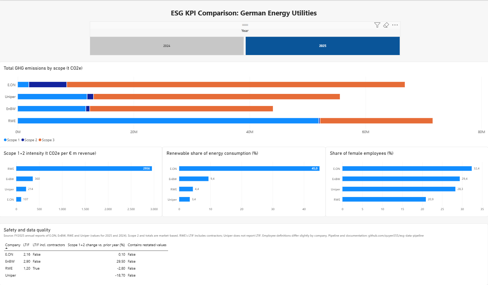

# ESG Data Pipeline: German Energy Utilities

End-to-end data pipeline that turns sustainability KPIs from the annual reports of four German energy utilities (**E.ON, EnBW, RWE, Uniper**) into a clean, tested, comparable dataset, and visualizes it in a Power BI dashboard.

Built on Databricks using a medallion architecture (bronze, silver, gold) with Python and SQL.



## Why this project

My bachelor thesis analyzed how German utilities report sustainability information under CSRD/ESRS. One finding: published ESG figures are hard to compare. Companies use different units, scopes, definitions and restate prior-year values. This project builds the pipeline that makes those figures comparable, and documents every decision needed along the way.

## Architecture

```
FY2025 annual reports (PDF)
        │  extraction into CSV, with source page for every value
        ▼
data/raw/utility_kpi_raw.csv          78 rows: 4 companies × 2 years × 10 KPIs
        │  01_bronze_ingestion (Python / PySpark)
        ▼
BRONZE  workspace.bronze.utility_kpis
        all columns as text, exactly as reported, plus load metadata
        │  02_silver_transform (SQL)
        ▼
SILVER  workspace.silver.utility_kpis
        typed values, units normalized (t CO2e, MWh), restatement flags, data tests
        │  03_gold_kpis (SQL)
        ▼
GOLD    workspace.gold.company_kpis
        one row per company and year, calculated KPIs, year-over-year change
        │  Import
        ▼
Power BI dashboard
```

## Tech stack

Python (pandas, PySpark) · SQL · Databricks (Unity Catalog, Delta tables, Git folders) · Power BI · Git / GitHub

## Repository structure

```
data/raw/      raw KPI extraction (CSV) and extraction template
notebooks/     01_bronze_ingestion, 02_silver_transform, 03_gold_kpis
dashboard/     Power BI report (.pbix) and screenshot
docs/          KPI definitions (kpi_list.md) and source page map (source_map.md)
```

## Data quality: what made the raw data hard to compare

| Issue | Example | How it is handled |
|---|---|---|
| Different units | Emissions in million t (E.ON, RWE), thousand t (EnBW), t (Uniper) | Silver converts everything to t CO2e and MWh |
| Number formats | `"84,791"`, `"11,907,517.3"` | Bronze keeps text as reported; silver parses with `TRY_CAST` |
| Restated prior-year values | EnBW and Uniper restated 2024 Scope 2 (Uniper by −742,399 t market-based) | Documented per value; `is_restated` flag in silver |
| Different KPI definitions | RWE's LTIF includes contractors, E.ON's and EnBW's do not; Uniper reports no LTIF | Documented; `ltif_includes_contractors` flag in gold |
| Different employee scopes | Apprentices and interns included or excluded depending on company | Year-end headcount used throughout; scope noted per company |
| Group vs. parent figures | EnBW's report also shows €71.7bn revenue for the parent EnBW AG (HGB), vs. €34.4bn for the group | Consolidated group figures used |

Every raw value carries its source document and page (`source_page`), so any number in the dashboard can be traced back to the report.

## Data tests

The silver notebook runs automated checks. Each query returns rows that break a rule, so the expected result is 0:

- value could not be parsed, or unit unknown
- duplicate company / year / KPI
- negative values
- percentages outside 0–100
- more female employees than total employees (cross-field check)

All tests pass.

## Validation against the reports

Calculated totals were reconciled with figures the companies report themselves:

| Check | Reported | Pipeline |
|---|---|---|
| EnBW total GHG 2025 (market-based) | 44,022 thousand t | 44,022,000 t ✓ |
| RWE total GHG 2025 / 2024 | 71.58 / 75.40 million t | 71,580,000 / 75,400,000 t ✓ |
| Uniper total GHG 2025 (market-based) | 55,576,276.1 t | 55,576,276 t ✓ |
| EnBW energy intensity 2025 | 1,166.0 MWh / € m | 1,166.0 ✓ |

One finding from this step: Uniper states its energy intensity as "0.001082044 MWh/€ millions". The pipeline calculates 1,082 MWh per € million, which suggests a unit error in the report by a factor of one million.

## Key findings (2025)

- **Size and intensity tell different stories.** RWE (71.6 Mt) and E.ON (66.8 Mt) have similar total emissions, but RWE's Scope 1+2 intensity is about 28 times higher (2,956 vs. 107 t CO2e per € m revenue).
- **Where emissions occur differs by business model.** RWE's emissions are 72% Scope 1 (own power plants). For E.ON, a grid and retail company, 87% are Scope 3, mostly from power and natural gas sold to end customers.
- **Renewable share of energy consumption** ranges from 45% (E.ON) to 3.4% (Uniper).
- **EnBW's Scope 1+2 emissions rose 29.5%** year over year, which the report attributes to higher utilization of its coal power plants. Uniper's fell 18.7%.
- **Share of female employees** ranges from 20.9% (RWE) to 32.4% (E.ON).

## Limitations

- Two years and four companies only; the pipeline structure supports more.
- Some KPIs are not fully comparable (LTIF, employee scopes); this is flagged rather than hidden.
- Raw values were extracted from PDFs into CSV. E.ON was extracted manually to define the extraction rules; the other three were extracted with AI assistance. Every value was verified against its source page.

## Next steps

- Move the silver and gold SQL into **dbt models**, with the data tests as dbt tests. The SQL is plain ANSI-style SQL in CTE form, so it would run on Snowflake with minor changes.
- Schedule the notebooks as a Databricks job.
- Add more reporting years to analyze trends.

## Sources

FY2025 annual reports (each including the prior year 2024): E.ON Integrated Annual Report 2025, EnBW Annual Report 2025, RWE Annual Report 2025, Uniper Annual Report 2025. The reports are publicly available on the companies' websites and are not redistributed in this repository.
